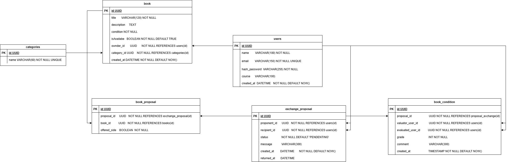
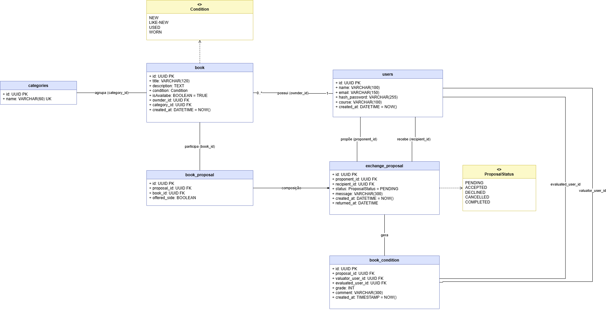

# API de Troca de Livros Universitária

API Java 21 / Spring Boot 3.5.7, PostgreSQL, JPA, Security/JWT, Bean Validation, Flyway e OpenAPI para organizar trocas de livros entre universitários. O projeto entrega o backend, sem frontend.

## Tema

Troca de livros no ambiente universitário, incentivando a circulação de exemplares entre estudantes e o reaproveitamento de materiais de leitura e estudo.

## Integrantes

- Rafael Teixeira Serafim
- Maria Joana Apolinário Ceron
- Gabriel Bada

## Problemas

O projeto busca resolver os seguintes problemas:

- Dificuldade de acesso a livros de interesse acadêmico sem comprar novos exemplares.
- Livros que ficam sem uso após uma disciplina ou leitura e poderiam atender outros estudantes.
- Dificuldade para encontrar quem possui um livro desejado e tem interesse em uma troca.
- Falta de controle sobre disponibilidade, propostas simultâneas e conclusão das trocas.
- Ausência de um histórico de trocas e avaliações que ajude os participantes a conhecer experiências anteriores.

## Domínio

O domínio é a troca de livros entre universitários. Cada usuário cadastra seus exemplares com título, autor, ISBN opcional, categoria, condição de conservação e disponibilidade. Uma proposta reúne livros oferecidos pelo proponente e livros solicitados ao destinatário.

| Conceito | Responsabilidade |
|---|---|
| Usuário | Possui livros, envia e recebe propostas e avalia trocas concluídas. |
| Livro | Representa um exemplar que pertence a um usuário e pode participar de trocas. |
| Categoria | Organiza os livros por assunto ou tipo. |
| Proposta de troca | Identifica os participantes e acompanha o estado da negociação. |
| Livro da proposta | Relaciona um exemplar à proposta e registra se foi oferecido ou solicitado. |
| Avaliação | Registra a nota e o comentário de um participante sobre o outro após a conclusão. |

Ao aceitar uma proposta, os livros são reservados. Ao concluir, a propriedade dos exemplares é transferida entre os participantes, preservando o histórico da troca. Cada participante pode avaliar a experiência uma única vez por proposta concluída.

## Diagramas

### Estrutura de dados



### Relacionamentos do domínio



Os diagramas fornecidos usam nomes em inglês; a implementação usa nomes em português. A entidade identificada como `book_condition` nos diagramas corresponde às avaliações e foi implementada como `avaliacoes`. A condição de conservação do livro é representada pelo enum `Condicao`.

## Executar

Requisitos: JDK 21, Docker com Compose e acesso ao Maven Central na primeira execução. O Maven Wrapper baixa Maven 3.9.9; não é necessário instalar Maven. A [documentação do Boot](https://docs.spring.io/spring-boot/3.5/system-requirements.html) exige Maven >= 3.6.3; springdoc 2.8.14 segue a [matriz de compatibilidade](https://springdoc.org/v2/).

```bash
cp .env.example .env
# Edite DB_PASSWORD e JWT_SECRET; gere a chave com: openssl rand -base64 48
set -a
. ./.env
set +a
docker compose up -d --wait
./mvnw spring-boot:run
```

Swagger: http://localhost:8080/swagger-ui.html. OpenAPI: http://localhost:8080/v3/api-docs. Use `Authorize` com o token recebido no login. A assinatura HS256 exige `JWT_SECRET` com pelo menos 32 bytes UTF-8; não existe segredo padrão. Validade: 3.600 segundos, com a tolerância de relógio padrão do Spring Security. Horários são `Instant` em UTC e `TIMESTAMPTZ` no PostgreSQL. O servidor inicia na porta 8080.

Variáveis: `DB_URL` (padrão `jdbc:postgresql://localhost:5432/troca`), `DB_USER` (padrão `troca`), `DB_PASSWORD` e `JWT_SECRET` (obrigatórias). O Compose usa o usuário/senha exportados ou lê `.env`. Para dados demonstrativos, exporte `SPRING_PROFILES_ACTIVE=dev` e `DEMO_PASSWORD` (8–72 bytes UTF-8) antes de iniciar. Esse perfil cria Ana e Bruno (`ana@universidade.edu`, `bruno@universidade.edu`) e dois livros; sem o perfil há apenas três categorias iniciais. Não há CRUD adicional de usuários ou categorias, recuperação de senha, refresh token ou papéis administrativos.

## Contrato HTTP

Todas as rotas exigem `Authorization: Bearer <token>`, exceto cadastro, login e Swagger.

| Método | Rota | Comportamento |
|---|---|---|
| POST | `/usuarios` | Cadastro público; 201 |
| POST | `/auth/login` | Login público; 200 e `accessToken`, `tokenType`, `expiresIn` |
| GET | `/categorias` | Listagem de categorias |
| POST | `/livros` | Criar livro do usuário autenticado; 201 |
| GET | `/livros` | Listagem de livros |
| GET | `/livros/{id}` | Consultar livro |
| PUT | `/livros/{id}` | Substituir dados editáveis; somente dono |
| DELETE | `/livros/{id}` | Excluir livro sem histórico; 204 |
| POST | `/propostas` | Criar proposta; 201 |
| GET | `/propostas/{id}` | Consultar; somente participantes |
| GET | `/usuarios/{id}/propostas` | Listar; ID deve ser o usuário autenticado |
| PATCH | `/propostas/{id}/aceitar` | Destinatário aceita proposta pendente |
| PATCH | `/propostas/{id}/recusar` | Destinatário recusa proposta pendente |
| PATCH | `/propostas/{id}/cancelar` | Proponente cancela proposta pendente |
| PATCH | `/propostas/{id}/concluir` | Qualquer participante conclui proposta aceita |
| POST | `/propostas/{id}/avaliacoes` | Avaliar troca concluída; 201 |
| GET | `/usuarios/{id}/avaliacoes` | Avaliações recebidas e agregados; qualquer autenticado |

Criações retornam `Location`. Consultas, atualizações e transições retornam 200. `Location` de cadastro identifica o usuário; não há GET individual de usuário. A avaliação aponta a coleção de avaliações do avaliado.

Enums: `condicao`: `NOVO`, `SEMINOVO`, `USADO`; `lado`: `OFERECIDO`, `SOLICITADO`; `status`: `PENDENTE`, `ACEITA`, `RECUSADA`, `CANCELADA`, `CONCLUIDA`. IDs são UUID. O dono, proponente e avaliador vêm do JWT; o avaliado é o outro participante. Campos JSON desconhecidos são rejeitados.

Limites: nome 100, email 150, curso opcional 100, categoria 60, título 120, autor obrigatório 150, ISBN opcional 20, descrição opcional 1.000, mensagem/comentário opcionais 300 caracteres; senha de 8 a 72 **bytes UTF-8**; nota inteira de 1 a 5. A proposta contém de 2 a 100 livros, incluindo ao menos um de cada lado e sem repetição. Nome, título e autor não podem ser vazios. ISBN é um identificador opcional, sem unicidade entre exemplares; não há validação de dígito verificador. Email é normalizado para minúsculas; senha armazenada apenas com BCrypt e nunca exposta.

## Paginação e filtros

Todas as listagens aceitam `page` (zero inicial), `size` (20 por padrão, de 1 a 100) e um único `sort=campo,asc|desc`. A resposta tem `content`, `page`, `size`, `totalElements`, `totalPages`; sempre há desempate por ID crescente. Campos de ordenação desconhecidos retornam 400.

| Listagem | Filtros opcionais | Ordenação permitida | Padrão |
|---|---|---|---|
| Livros | `categoriaId`, `condicao`, `disponivel`, `donoId`, `titulo` | `titulo`, `criadoEm` | `criadoEm,desc` |
| Categorias | `nome` | `nome` | `nome,asc` |
| Propostas | `status`, `participacao=ENVIADAS\|RECEBIDAS` | `criadoEm` | `criadoEm,desc` |
| Avaliações | — | `criadoEm`, `nota` | `criadoEm,desc` |

Filtros são combinados com AND; título/nome procuram parte do texto sem distinguir maiúsculas (os caracteres `%` e `_` são literais). Avaliações retornam `{ "avaliacoes": <página>, "media": 4.5, "quantidadeTotal": 2 }`; média e quantidade consideram todas as avaliações recebidas, independentemente da página. Sem avaliações, `media` é `null`.

## Exemplo

```bash
curl -i http://localhost:8080/usuarios -H 'Content-Type: application/json' \
  -d '{"nome":"Ana","email":"ana@universidade.edu","senha":"senha-segura","curso":"Computação"}'
curl http://localhost:8080/auth/login -H 'Content-Type: application/json' \
  -d '{"email":"ana@universidade.edu","senha":"senha-segura"}'
# Copie accessToken do login:
TOKEN='substitua-pelo-token'
curl -i http://localhost:8080/livros -H "Authorization: Bearer $TOKEN" \
  -H 'Content-Type: application/json' \
  -d '{"titulo":"Cálculo I","autor":"James Stewart","condicao":"USADO","categoriaId":"10000000-0000-0000-0000-000000000001"}'
curl 'http://localhost:8080/livros?condicao=USADO&disponivel=true&sort=titulo,asc&size=20' \
  -H "Authorization: Bearer $TOKEN"
```

Exemplo de proposta (substitua os UUIDs pelos usuários/livros criados; em perfil `dev`, esses IDs são os de Ana, Bruno e seus livros):

```json
{
  "destinatarioId": "20000000-0000-0000-0000-000000000002",
  "mensagem": "Vamos trocar nossos livros?",
  "livros": [
    {"livroId": "30000000-0000-0000-0000-000000000001", "lado": "OFERECIDO"},
    {"livroId": "30000000-0000-0000-0000-000000000002", "lado": "SOLICITADO"}
  ]
}
```

Envie esse JSON a `POST /propostas` autenticado como Ana. Bruno chama `PATCH /propostas/{id}/aceitar`; Ana ou Bruno chama `PATCH /propostas/{id}/concluir`. Cada um então envia `{"nota":5,"comentario":"Ótima troca"}` a `POST /propostas/{id}/avaliacoes`.

O fluxo completo também é executável, sem copiar tokens e sem bibliotecas Python externas:

```bash
python3 scripts/smoke.py
# Opcional: BASE_URL=http://localhost:8081 python3 scripts/smoke.py
```

O script cria dois usuários e dois livros de teste, realiza a troca, verifica a transferência e publica as duas avaliações. Os dados ficam no banco.

## Regras e concorrência

Criar e aceitar exige disponibilidade e propriedade correta de todos os livros. Aceitar reserva todos os livros e cancela outras propostas pendentes que compartilhem qualquer um deles. Não se pode alterar livro reservado. Livros com qualquer histórico de proposta não podem ser excluídos. Alterações em propostas pendentes são permitidas; a aceitação revalida os dados. Concluir transfere a propriedade ao participante oposto e restaura a disponibilidade; os lados originais ficam preservados. Repetir transições ou avaliações retorna 409.

As mutações de livros, propostas e avaliações adquirem primeiro um bloqueio pessimista transacional consultivo do PostgreSQL (`pg_advisory_xact_lock`), compartilhado entre instâncias, e depois bloqueiam os livros por UUID em ordem determinística (`FOR UPDATE`). O bloqueio global simplifica a garantia de ausência de reservas/transferências parciais e evita ciclos entre propostas que compartilham livros; em contrapartida, serializa essas mutações. Para este escopo acadêmico, prioriza consistência sobre vazão. Leituras continuam concorrentes. O timeout de espera é 10 segundos; conflitos de persistência são traduzidos para 409, com rollback integral. A leitura dos agregados de avaliações usa snapshot consistente.

## Banco e migrações

Flyway aplica as migrações em `src/main/resources/db/migration/`; Hibernate usa apenas `validate`. Há seis tabelas: `usuarios`, `categorias`, `livros`, `propostas`, `proposta_livros`, `avaliacoes`. Há restrições para enums, notas, participantes distintos, email normalizado e único, categoria sem distinção de caixa, pares proposta/livro e proposta/avaliador. Chaves estrangeiras preservam o histórico.

A V1 original é mantida para preservar o checksum de bancos já inicializados. A V2 renomeia as tabelas para `livros`/`proposta_livros` e a referência para `livro_id`, adiciona autor e ISBN e ajusta as categorias iniciais para Didáticos, Literatura e Tecnologia. UUIDs, proprietários, propostas e avaliações são preservados. Livros anteriores recebem o marcador `Autor não informado`; o dono pode preencher o autor pela atualização do livro, respeitando as regras de reserva. O contrato HTTP atual usa `/livros`, `livros` e `livroId`. Clientes da versão anterior precisam atualizar os caminhos/campos e fazer login novamente para obter tokens com o emissor `troca-livros`.

`troca_livros.sql` contém o mesmo esquema e categorias, em transação, para criação manual. **Escolha um método**:

- Recomendado: banco vazio e Flyway habilitado (padrão).
- Manual: execute `psql "$URL_POSTGRES" -v ON_ERROR_STOP=1 -f troca_livros.sql` em banco vazio e inicie a API com `SPRING_FLYWAY_ENABLED=false`. `URL_POSTGRES` usa URI PostgreSQL, não JDBC. Não execute a migração Flyway sobre esse banco sem um procedimento de baseline deliberado.

## Verificar

```bash
./mvnw verify
```

Os testes exigem Docker funcional e usam PostgreSQL 17 real via Testcontainers, sem substituição por H2 e sem omitir testes quando Docker estiver indisponível. Não precisam de `.env` nem de banco prévio: JWT e credenciais são exclusivos dos testes. Cobrem migração/validação JPA, fluxo HTTP completo, regras dos services, concorrência de aceitações, rollback, permissões, validação, unicidade, restrições SQL, filtros, paginação/ordenação, histórico e agregados.

No Docker Desktop para Linux, se o socket não for detectado automaticamente:

```bash
export DOCKER_HOST="unix://$HOME/.docker/desktop/docker.sock"
export TESTCONTAINERS_DOCKER_SOCKET_OVERRIDE=/var/run/docker.sock
./mvnw verify
```

Se o Maven global tiver um mirror corporativo indisponível, use um `settings.xml` pessoal que aponte para Maven Central (`./mvnw -s /caminho/settings.xml verify`). O projeto não modifica configurações globais.
